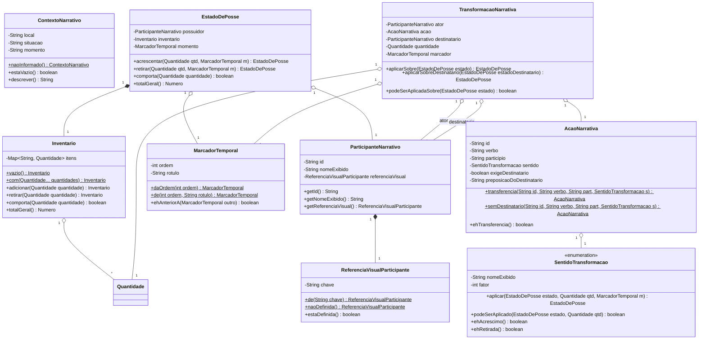
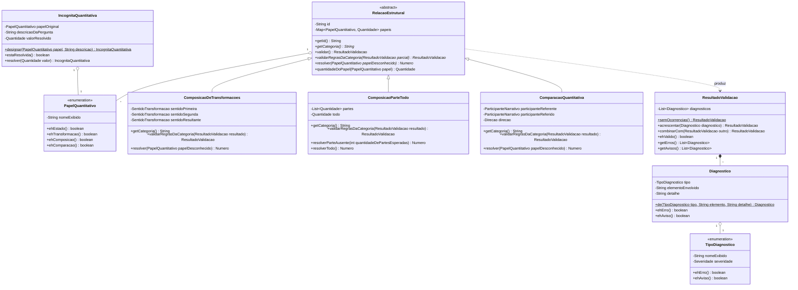
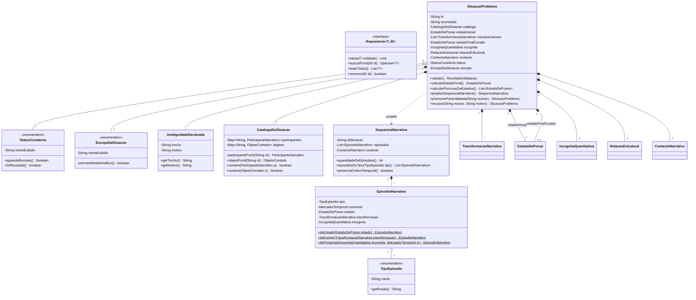
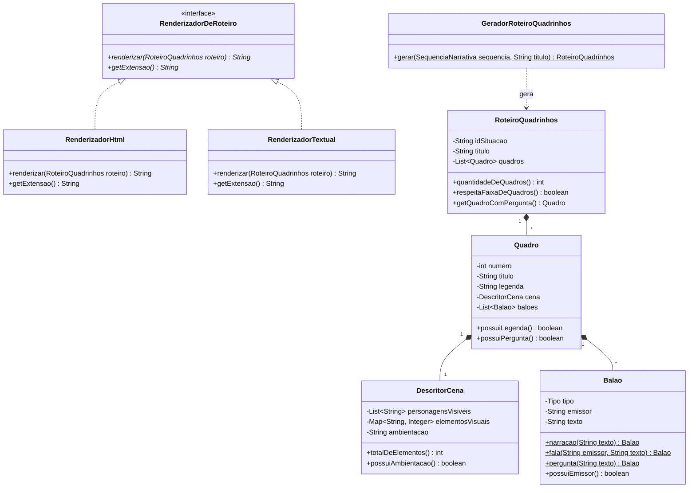
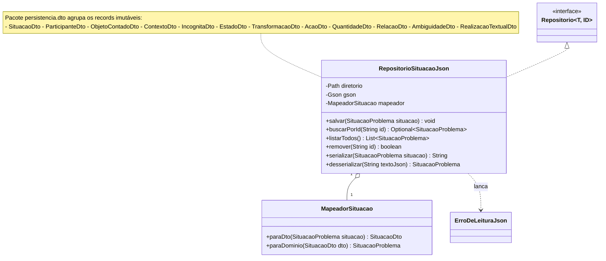
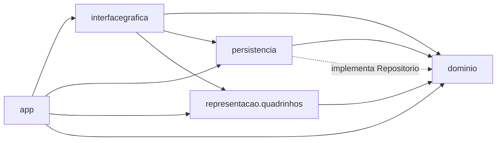

# Diagrama de Classes - Gerard Curadoria

Este documento apresenta a arquitetura estática e a estrutura de classes do sistema **Gerard Curadoria**, subdividida em diagramas por camada lógica para facilitar a leitura e compreensão do modelo de domínio, representação em quadrinhos e persistência.

---

## 1. Camada Quantitativa e Exceções de Domínio (`dominio.quantitativo` e `dominio.excecao`)

Modela as grandezas, unidades, números inteiros com semântica de domínio, famílias de objetos e quantidades imutáveis, além da hierarquia de exceções específicas de regras quantitativas.

```mermaid
classDiagram
    direction TB

    class Numero {
        -int valor
        +de(int valor)$ Numero
        +getValor() int
        +somar(Numero outro) Numero
        +subtrair(Numero outro) Numero
        +diferencaAbsolutaPara(Numero outro) Numero
        +ehNegativo() boolean
        +ehZero() boolean
    }

    class GrandezaQuantitativa {
        <<enumeration>>
        -String nomeExibido
        +aceitaUnidade(UnidadeMedida unidade) boolean
        +ehCompativelCom(GrandezaQuantitativa outra) boolean
        +getUnidadePadrao() UnidadeMedida
    }

    class UnidadeMedida {
        <<enumeration>>
        -GrandezaQuantitativa grandeza
        -String singular
        -String plural
        +flexionar(Numero numero) String
        +ehCompativelCom(UnidadeMedida outra) boolean
    }

    class FamiliaObjeto {
        -String id
        -String nomeConceitual
        +getId() String
        +getNomeConceitual() String
    }

    class CaracteristicaObjeto {
        -String dimensao
        -String valor
        +de(String dimensao, String valor)$ CaracteristicaObjeto
        +getDimensao() String
        +getValor() String
    }

    class RealizacaoTextualObjeto {
        -String singular
        -String plural
        -String idioma
        +emPortugues(String singular, String plural)$ RealizacaoTextualObjeto
        +flexionar(Numero numero) String
        +descrever(Numero numero) String
    }

    class ReferenciaVisual {
        -String chave
        +de(String chave)$ ReferenciaVisual
        +naoDefinida()$ ReferenciaVisual
        +estaDefinida() boolean
    }

    class ObjetoContado {
        -String id
        -FamiliaObjeto familia
        -Set~CaracteristicaObjeto~ caracteristicas
        -RealizacaoTextualObjeto realizacaoTextual
        -ReferenciaVisual referenciaVisual
        +quantificar(Numero n, GrandezaQuantitativa g, UnidadeMedida u) Quantidade
        +contar(int quantosItens) Quantidade
        +pertenceAFamilia(FamiliaObjeto outra) boolean
    }

    class Quantidade {
        -Numero numero
        -ObjetoContado objeto
        -GrandezaQuantitativa grandeza
        -UnidadeMedida unidade
        +somar(Quantidade outra) Quantidade
        +subtrair(Quantidade outra) Quantidade
        +ehCompativelCom(Quantidade outra) boolean
        +comportaRetiradaDe(Quantidade outra) boolean
    }

    class ViolacaoDeDominioException {
        <<abstract>>
    }

    class QuantidadeIncompativelException {
    }

    class RetiradaImpossivelException {
    }

    ViolacaoDeDominioException <|-- QuantidadeIncompativelException
    ViolacaoDeDominioException <|-- RetiradaImpossivelException

    Quantidade "1" o-- "1" Numero
    Quantidade "1" o-- "1" ObjetoContado
    Quantidade "1" o-- "1" GrandezaQuantitativa
    Quantidade "1" o-- "1" UnidadeMedida

    ObjetoContado "1" o-- "1" FamiliaObjeto
    ObjetoContado "1" *-- "*" CaracteristicaObjeto
    ObjetoContado "1" *-- "1" RealizacaoTextualObjeto
    ObjetoContado "1" *-- "1" ReferenciaVisual
    UnidadeMedida --> GrandezaQuantitativa
```

---

## 2. Camada Narrativa (`dominio.narrativo`)

Modela os agentes da história, ações com sentidos de transformação, inventários aditivos e a evolução dos estados de posse ao longo do tempo narrativo.

---

## 3. Camada Estrutural e Validação (`dominio.estrutural` e `dominio.validacao`)

Modela as estruturas do raciocínio aditivo (transformações, parte-todo, comparação quantitativa) fundamentadas na categorização de Gerard Vergnaud, além do motor de validação e diagnóstico semântico.

---

## 4. Camada de Situação e Repositório (`dominio.situacao` e `dominio.repositorio`)

Reúne o agregado principal `SituacaoProblema`, que orquestra catálogo, contexto, estados de posse, transformações narrativas, relação estrutural e a projeção temporal da sequência de episódios.

---

## 5. Camada de Representação em Quadrinhos (`representacao.quadrinhos`)

Transforma a sequência narrativa formalizada em roteiros de histórias em quadrinhos com cenas, quadros, balões e renderizadores em diferentes formatos de saída.

---

## 6. Camada de Persistência (`persistencia`)

Implementa a persistência das situações-problema em arquivos JSON através do repositório, desacoplando o modelo de domínio dos formatos de serialização por meio de Data Transfer Objects (DTOs).

---

## 7. Visão Geral das Dependências entre Pacotes

Apresenta o fluxo arquitetural unidirecional de dependências entre módulos, onde a camada de domínio permanece isolada e independente de infraestrutura ou interface gráfica.

